# Firebird PSQL Debugger

Plugin do DBeaver CE 26.2.2 para depurar Rotinas PSQL do Firebird 5. Vocabulário em `GLOSSARY.md`, decisões em `docs/adr/`.

Como o depurador funciona por dentro: `docs/como-funciona.md`.

## Instalação

### Requisitos

- DBeaver CE **26.2.2**. O plugin traz um `org.eclipse.debug.ui` fixado para a plataforma Eclipse dessa versão (ADR 0004); outra versão do DBeaver pode não carregar.
- Firebird 5 local, com a conexão já criada no DBeaver.
- Para compilar o zip (ver "Gerar o zip de instalação"): JDK 21 no `JAVA_HOME`.

### Instalar

1. Obtenha o zip `firebird-psql-debugger-<versão>.zip`. Não descompacte.
2. No DBeaver: **Help > Install New Software…**

   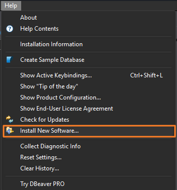

3. Na janela *Install*, clique em **Add…**.

   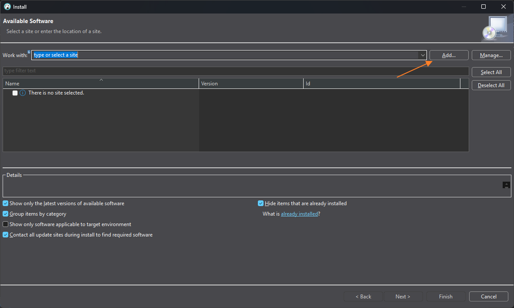

4. Em *Add Repository*, clique em **Archive…** e escolha o zip.

   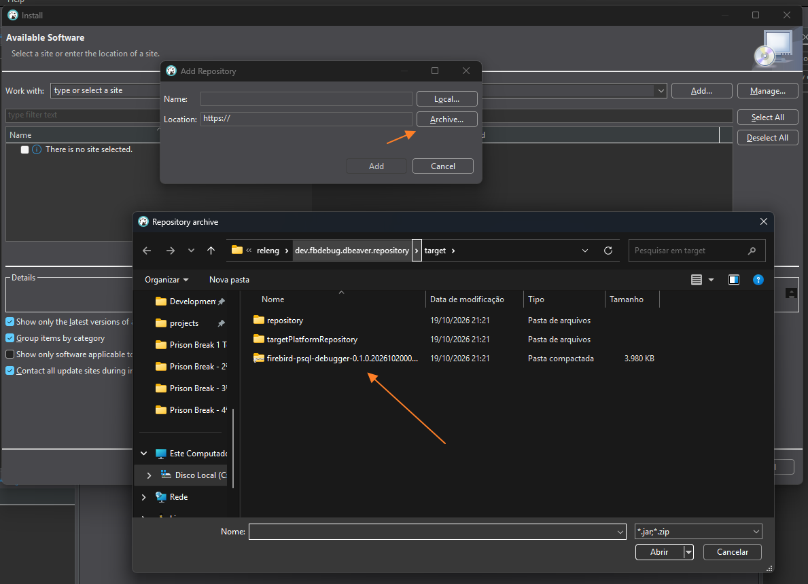

5. Com o caminho `jar:file:...zip!/` preenchido em *Location*, clique em **Add**. O campo *Name* pode ficar vazio.

   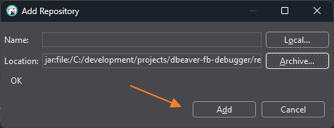

6. Marque **Firebird PSQL Debugger** e clique em **Next** até a licença. Aceite a licença e clique em **Finish**.

   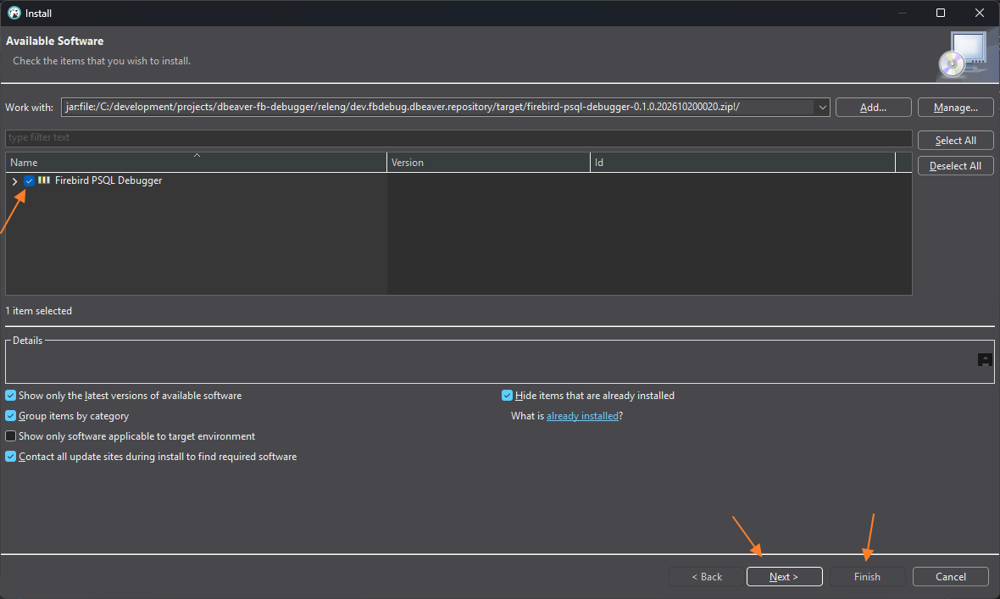

7. Pode aparecer *Trust Authorities*, pedindo confiança em `https://dbeaver.io`, que é o site de atualizações do próprio DBeaver. Clique em **Select All** e depois em **Trust Selected**.

   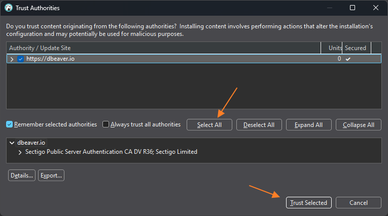

8. Em *Trust Artifacts*, o DBeaver avisa que o plugin não é assinado (é interno). Marque a linha **Unsigned** e clique em **Trust Selected**.

   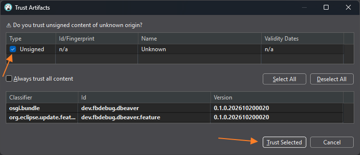

9. Aceite reiniciar o DBeaver com **Restart Now**.

   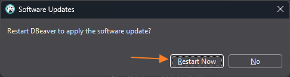

Depois do reinício aparece o menu **PSQL Debug** na barra de menus. Veja "Utilização" abaixo.

### Desinstalar

**Help > Installation Information**, aba *Installed Software*: selecione **Firebird PSQL Debugger**, clique em **Uninstall…**, confirme e reinicie o DBeaver.

### Atenção: `-clean` remove o plugin

O DBeaver guarda os plugins instalados desse jeito numa área de cache da pasta `configuration/`. Iniciar o DBeaver com `-clean` (pela linha de comando ou no `dbeaver.ini`) apaga essa área, e o plugin some **sem nenhum aviso**: o menu **PSQL Debug** deixa de aparecer. Para voltar, instale o zip de novo (ADR 0004, consequências). Isso vale para qualquer extensão instalada por "Install New Software" no DBeaver.

### Em caso de erro

O log fica no workspace do DBeaver: `%APPDATA%\DBeaverData\workspace6\.metadata\`.

- `.log`: erros da plataforma Eclipse, como falha ao carregar o plugin ou o `org.eclipse.debug.ui`.
- `dbeaver-debug.log`: log do próprio DBeaver. As cópias antigas ficam como `dbeaver-debug-<número>.log`.

Ao relatar um problema, mande esses arquivos junto com a Rotina e o passo que falhou. Os avisos da Sessão de debug (chamadas executadas no servidor, erros do Firebird) aparecem também no console da sessão, na view **Console**.

## Utilização

### 1. Abrir a Rotina e marcar breakpoints

Abra a procedure, function ou trigger pelo navegador do DBeaver e vá para a pasta **Source** do editor. O editor precisa estar salvo: o launch é recusado com alterações pendentes.

Para alternar um breakpoint numa linha, use um destes:

- duplo-clique na margem esquerda (ruler) da linha;
- **Ctrl+Shift+B** com o cursor na linha;
- botão direito no ruler > **Alternar Breakpoint**.

Os breakpoints valem só enquanto o editor da Rotina está aberto e não são salvos.

### 2. Iniciar a Sessão de debug

Com o editor da Rotina ativo, escolha **Depurar Rotina** no menu de contexto do texto ou no menu **PSQL Debug**. Na imagem, o ponto azul na margem é um breakpoint.

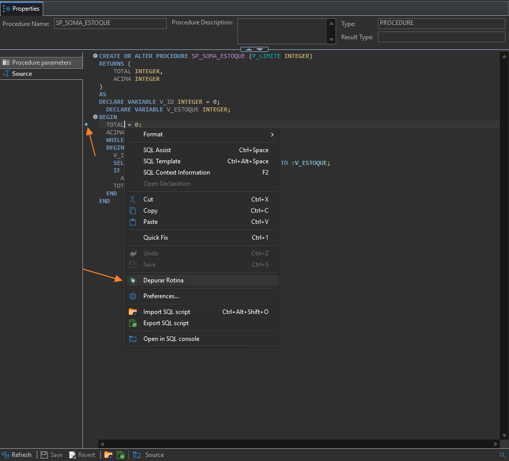

No menu **PSQL Debug**, **Depurar Rotina** fica inativo quando nenhum editor de Rotina Firebird está ativo.

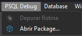

### 3. Informar os parâmetros

No diálogo de launch:

- **Parâmetros de entrada:** para cada parâmetro, escolha **Valor** e digite o valor, ou escolha **NULL**. Um parâmetro com valor padrão na declaração também oferece **Padrão**. O servidor converte o texto para o tipo do parâmetro, como num `CAST`. Numa trigger, o diálogo pede os valores de `NEW`/`OLD` e o evento.
- **Isolamento:** `READ COMMITTED` ou `SNAPSHOT`.
- **Commit ao terminar:** desmarcado, tudo o que a Rotina fizer é desfeito no fim da sessão (rollback). Marque só se quiser que as alterações fiquem no banco.

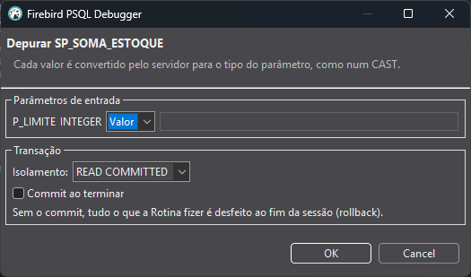

### 4. Depurar

O DBeaver troca para a perspectiva **Debug** e a execução para no primeiro breakpoint alcançado. Sem breakpoint, a Rotina roda até o fim e o resultado sai no console.

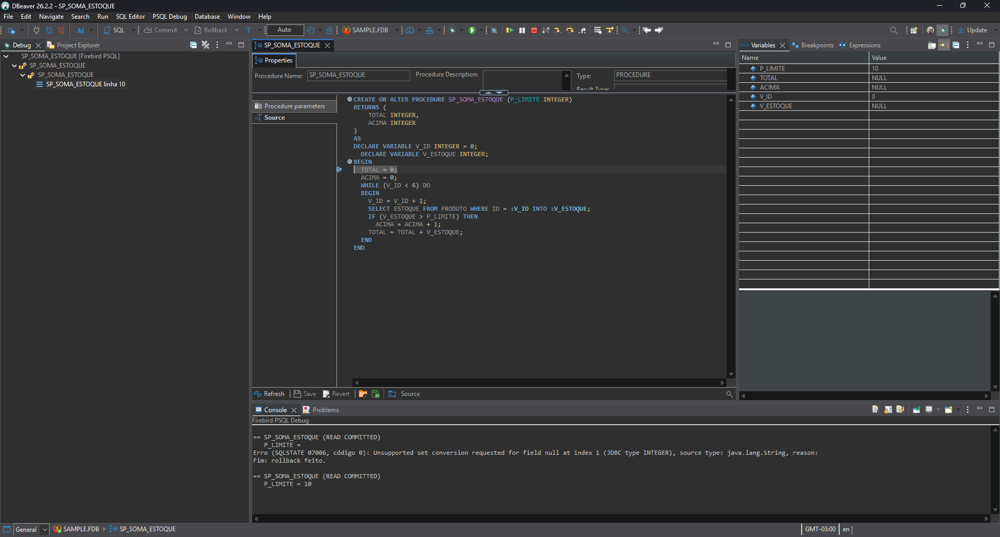

- **Debug** (à esquerda): a pilha de chamadas. Clique num nível para ver a linha e as variáveis dele.
- **Editor:** a seta na margem marca a próxima linha a executar.
- **Variables:** parâmetros, variáveis locais e de saída. Para alterar um valor durante a pausa, clique na coluna *Value* e digite.
- **Breakpoints:** lista, desativa e remove breakpoints.
- **Expressions:** watches, expressões PSQL (por exemplo `TOTAL * 2`) avaliadas no servidor a cada pausa. Para criar um watch, clique em *Add new expression* na própria view. O watch não altera o banco.
- **Console:** parâmetros usados, chamadas executadas no servidor, erros e o desfecho da sessão (commit ou rollback).

Atalhos, os mesmos do Eclipse:

| Tecla | Ação |
| ----- | ---- |
| F5 | Step into: entra na Rotina chamada por `EXECUTE PROCEDURE` ou em sub-rotina |
| F6 | Step over: executa a linha atual |
| F7 | Step return: termina a Rotina atual e para em quem a chamou |
| F8 | Resume: segue até o próximo breakpoint ou o fim |

Para encerrar a sessão antes do fim, use o botão **Terminate** (quadrado vermelho) da barra de ferramentas.

Chamadas dentro de um comando SQL (por exemplo, uma function num `SELECT`) rodam no servidor sem pausa, e a linha ganha um aviso na margem.

### Rotinas de package

O DBeaver não mostra as packages do Firebird. Use **PSQL Debug > Abrir Package…**, com a conexão selecionada no navegador. O corpo da package abre num console só de leitura, onde você marca os breakpoints e usa **Depurar Rotina** com o cursor na rotina desejada.

## Desenvolvimento

### Requisitos

- DBeaver CE 26.2.2 instalado na pasta padrão (`%LOCALAPPDATA%\DBeaver`). Os bundles dele são a target platform.
- JDK 21 no `JAVA_HOME` (o Tycho 5 exige Java 21).
- Acesso a `download.eclipse.org`: o `org.eclipse.debug.ui` vem do repositório do Eclipse 4.41.

### Build pela linha de comando

```
.\mvnw verify
```

Gera o plugin em `bundles/dev.fbdebug.dbeaver/target/` e o repositório p2 instalável em `releng/dev.fbdebug.dbeaver.repository/target/firebird-psql-debugger-<versão>.zip`.

O parser PSQL é gerado pelo ANTLR a partir de `bundles/dev.fbdebug.dbeaver/antlr4/` em `target/generated-sources/antlr4/` (que o `build.properties` inclui como fonte). O runtime do ANTLR vai embutido no plugin (`lib/`).

Depois de mudar a gramática, use `.\mvnw clean verify`: a compilação incremental do Tycho não recompila as classes que só usam as constantes de token do léxico (o Java as embute), e um token novo desloca os números.

### Gerar o zip de instalação

O zip que a equipe instala no DBeaver é o repositório p2. Para gerá-lo:

1. Abra um terminal (PowerShell) na raiz do repositório.
2. Rode `.\mvnw clean verify`. Sem um Firebird 5 local configurado para os Testes diferenciais (ver abaixo), rode `.\mvnw clean verify -DskipTests`.
3. Confira `BUILD SUCCESS` no fim da saída.
4. O zip fica em `releng\dev.fbdebug.dbeaver.repository\target\firebird-psql-debugger-0.1.0.<data-hora>.zip`. O sufixo é o *qualifier* do Tycho (`aaaaMMddHHmm`, em UTC), então cada build gera um nome novo.

O zip contém a feature, o plugin `dev.fbdebug.dbeaver` (com o runtime do ANTLR embutido) e o `org.eclipse.debug.ui` (ADR 0004). O `clean` garante que não sobra zip de build anterior em `target/`.

### Testes diferenciais

O `verify` roda os testes JUnit do plugin, e os Testes diferenciais (ADR 0005) precisam de um **Firebird 5 local**:

1. Copie `fbdebug-test.properties.example` para `fbdebug-test.properties` na raiz (o arquivo fica fora do git) e ajuste host, porta, credenciais e o caminho do banco.
2. O banco indicado em `database` é **apagado e recriado** a cada execução da suíte. Use um arquivo só para isso.

Para gerar o build sem um Firebird disponível: `.\mvnw verify -DskipTests`.

### IDE: Eclipse IDE for RCP and RAP Developers

1. Instale o pacote "Eclipse IDE for RCP and RAP Developers", 2026-09 ou mais novo.
2. **File > Import > Maven > Existing Maven Projects**, apontando para a raiz do repositório e importando todos os módulos. Se o Eclipse oferecer o conector do Tycho ("Tycho Project Configurators"), aceite.
3. Abra `releng/dev.fbdebug.dbeaver.target/dev.fbdebug.dbeaver.target.target` e clique em **Set as Active Target Platform** (canto superior direito do editor). Espere a resolução; na primeira vez ela baixa o `debug.ui`.
4. Para rodar o DBeaver com o plugin: clique com o botão direito em `DBeaver com Firebird PSQL Debugger.launch` (mesmo projeto) e escolha **Debug As > DBeaver com Firebird PSQL Debugger**. Breakpoints no código do plugin funcionam direto.
   - Esse DBeaver usa um workspace separado (`runtime-dbeaver-fbdebug`, ao lado do workspace do Eclipse), sem as conexões do DBeaver de uso diário. Crie lá a conexão com o Firebird local.

O `.target` é o mesmo usado pelo `mvnw`, então o que compila na IDE compila no build.

#### Testes na IDE

Os testes ficam em `bundles/dev.fbdebug.dbeaver/test/` e são JUnit comum, sem OSGi. O m2e não configura essa pasta sozinho, então faça uma vez por workspace:

1. No projeto do bundle, rode **Maven > Update Project** (Alt+F5). Isso roda o ANTLR e põe o JUnit, o Jaybird e o runtime do ANTLR em *Maven Dependencies*.
2. Em **Project > Properties > Java Build Path > Source**:
   - confira se aparecem `src` e `target/generated-sources/antlr4`, e adicione as que faltarem com *Add Folder…*;
   - adicione `test` e marque **Contains test sources: Yes**;
   - marque **Allow output folders for source folders** e defina o *Output folder* de `test` como `target/test-classes`. Uma pasta de testes precisa de uma pasta de saída própria.
3. Para rodar: botão direito em `test` > **Run As > JUnit Test**. Não use "JUnit Plug-in Test".

O `fbdebug-test.properties` é achado subindo a partir da pasta do projeto. Se o código de `src/` não achar `org.antlr...`, use **PDE Tools > Update Classpath…**.

## Licença

MIT: pode usar, copiar, modificar e redistribuir à vontade, inclusive em projetos comerciais. Veja [LICENSE](LICENSE).

Os componentes de terceiros incluídos (`org.eclipse.debug.ui`, sob EPL 2.0, e o runtime do ANTLR 4, sob BSD 3-Clause) seguem com as licenças originais. Veja [NOTICE](NOTICE).
